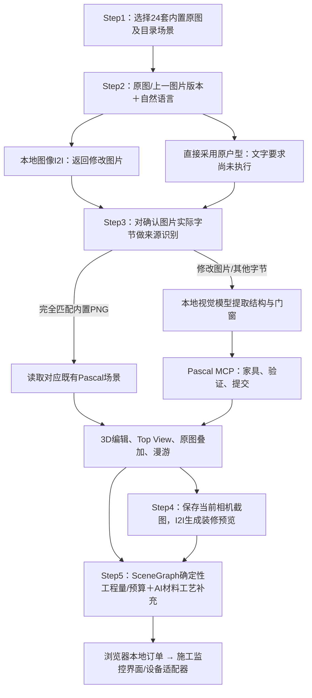

# Ideal Home / DreamHouse：GPT 上下文交接审计

审计日期：2026-10-13，Asia/Hong_Kong。目的：说明当前实际代码和部署的能力边界，供 GPT 继续分析。**本次只读审计，没有修改业务代码、重启服务或执行新的高成本模型实验。**新增交付为本报告及脱敏证据摘要 `EVIDENCE_SUMMARY.json`。

## 1. 审计对象、版本和证据规则

- **当前真实工作树**：AI 主机 `/home/amd/Workspace/Ideal-house`；分支 `CIIE`；HEAD `6206678170a50f136f99a5cad5c98842187fb910`，提交时间 2026-09-30 13:25:51 +08:00，标题 `feat: optimize local Vulkan AI image pipeline`。
- **HEAD 不能完整代表当前版本**：审计前还有 32 条修改/新增文件记录，包含已运行的图像、Step3、队列、取消及保存恢复修复。只检出 HEAD 会丢失这些改进。当前 Web 镜像为 `553e140bb8403840c95ad6521ffe2f048cda06d7253d224c65c4fac3fc813a14`。
- 当前 Windows 聊天目录是项目外目录，原有 `work/ideal-house` 是上次镜像。本次于14:31 +08:00从上述 AI 主机工作树重新提取 284 个源码、配置及文本数据文件，未以旧镜像为依据；23 个关键文件与远端工作树哈希一致，另外检查的部署文件也与当前源码一致。模型文件元数据和小型二进制资产另外核对。**UNKNOWN**：若用户另有独立 Windows 新版仓库，该副本未纳入本报告。
- 旧参考仓库固定到 [main/b3778a49](https://github.com/EthanHUOvO/Ideal_home/tree/b3778a49b0a60237df46c339bcf159dfe3421bef)，提交时间 2026-09-24 11:34:26 +08:00；只用于有限文件对照。未把旧 README 当作当前调用链。
- `package.json:2` 标识 v14，`app/layout.tsx:3` 页面标题仍为 v11；它们是显示标签，不是代码或模型版本依据。

后文 `文件:行号` 均相对真实仓库根目录，定位基于本次快照。证据摘要包含时间、代码哈希、运行镜像、测量结果和原件位置，不包含密钥、密码或完整环境变量。

为便于定位，简称 Portal＝`components/customer/TouchCustomerPortal.tsx`，PascalViewer＝`components/shared/PascalViewer.tsx`，compose＝`deploy/local-ai/compose.yaml`；AI helper 位于 `lib/ai/`，Blueprint＝`lib/floorplans/blueprint.ts`，imported-two＝`lib/floorplans/pascal-v2/imported-two.ts`，worker 位于 `services/`。完整关键文件路径见证据摘要。

| 状态 | 本报告含义 |
|---|---|
| **已验证** | 已核对源码调用关系，或有明确运行/测试证据；注明证明范围。源码确认不自动等于端到端成功。 |
| **仅实现未验证** | 实现或接口存在，目标运行场景尚无充分实测。 |
| **存在问题** | 源码因果链或本次/既有测量确认的缺陷、能力缺口。 |
| **UNKNOWN** | 证据不足；不推断为成功或失败。 |

## 2. 当前架构及完整运行链

**已验证：**Next.js 16.3.4 / React 19.2.8 / Node 22.23.3；TypeScript；Pascal `1.0.0-beta.4`、Three.js、React Three Fiber；MCP SDK 1.30.1。浏览器界面主要是 `TouchCustomerPortal.tsx`，服务端是 Next Route Handlers；本地 AI Gateway 转发给独立图像进程、llama.cpp 和 Pascal MCP。`PascalViewer.tsx:3–10` 实际使用 Pascal Viewer/Editor；`lib/pascal/bootstrap.ts:7` 加载内置节点插件。

| 环节 | 实际行为与证据 |
|---|---|
| Step1 | one/two/three 正常分支直接读取对应 imported Pascal JSON 后提前返回，无模型识别。`TouchCustomerPortal.tsx:1718,1791,1805,1820`；`imported-two.ts:121`。`/api/ai/import-floorplan` 是确定性目录接口，正常三类选择已提前 return，不应根据其名称宣称 AI 导入（Portal `:1840`；该 route `:24`）。 |
| Step2 | `startDesignAdjustment → generateFloorplan → /api/ai/floorplan-image → image-service → qwen-image-client → Gateway/image → 原生图像 CLI`。只传图片和文字；独立 Qwen27B 布局代理不参与此按钮。Portal `:2354,2375,2019,2052`；route `:14,39`；image-service `:96,111,149`。 |
| Step3 | 先做实际图像字节 SHA256 目录匹配；未命中才调用视觉模型和 MCP。route `:68,75`；`verified-preset-scene.ts:29`；`local-model3d-agent.ts:102`。失败 preview 明确标记 fallback，不能当作重建成功。 |
| Step4 | 每次选一个已保存的漫游/相机截图，最多保存 5 个视角；截图＋房间/风格进入 `/api/ai/render-view`。返回 AI 图片，不回写墙、门或 SceneGraph。Portal `:1017,2219,2239`；`services/qwenImageService.ts:30`；render-view route `:44`。旧 README 的自动全屋轴测＋逐房间批量生成不是当前按钮行为。 |
| Step5 | 数量、尺寸、面积和预算由规则计算；Qwen 文本模型最多补充前 12 个 BOM 条目的材料/工艺，不能改变数量。`bom/tools.ts:26,37,49`；`bom/residential.ts:82`；`bom/service.ts:8,20`；`qwen-provider.ts:34–45`。客户端失败时仍可生成本地预算（Portal `:2289–2347`）。本轮未新跑真实 BOM 推理，完整效果 **UNKNOWN**。 |
| 施工侧 | 提交将 SceneGraph、预算、效果图写入浏览器 `localStorage`；施工页读取同一 origin 的订单，再轮询设备状态。Portal `:2454,2528`；`order-store.ts:8–16`；`ContractorPortal.tsx:11`；`ExecutionMonitoring.tsx:155,168`。无中心订单数据库，3000/3001 及不同设备不会自然共享订单。当前监控页并非自动下发制造任务的闭环；真实打印/机器人执行 **UNKNOWN**。 |

浏览器使用 `sessionStorage` 标识会话、`localStorage` 保存设计/Blueprint/订单、IndexedDB 保存生成图 Blob（`session.ts:1–30`；`floorplan-assets.ts:13,26`）。服务器生成图在 `/srv/ideal-home/data/generated`，MCP 提交场景在 `/srv/ideal-home/data/scenes`。保留图片、场景和相机字段属于关联记录，不能证明视觉结果与几何完全一致。

### 与旧 GitHub 版本实际完成的差异

旧 main 的 Step3 是延时预制模型准备逻辑（[旧 Portal:947](https://github.com/EthanHUOvO/Ideal_home/blob/b3778a49b0a60237df46c339bcf159dfe3421bef/components/customer/TouchCustomerPortal.tsx#L947)）；当前已增加真实 SSE/MCP 视觉建模、原图字节验证复用、失败状态及恢复逻辑。旧参考没有 `deploy/local-ai/compose.yaml`、`model3d/stream` 和本地 sd.cpp 服务；当前已有双端口 Vulkan 部署、实际图像后端、4Step 适配器、队列与取消。旧云 API 默认配置已被当前生产强制 local 模式替代（`lib/ai/config.ts:6`）。

**没有完成的改造：**旧 main 与当前的 `qwen-layout-agent.ts`、`layout-tools.ts` 文件内容相同；Step2 仍为纯图片编辑。不能把旧 README 中的结构编辑描述，或前次讨论的“几何优先”建议，当作已经上线的功能。

## 3. AI Max+ 395 实际本地部署

**已验证：**AMD Ryzen AI Max+ 395 / Radeon 8060S，16 核 32 线程；选中的推理服务使用 Vulkan/RADV GFX1151。未见这些服务使用 CUDA、PyTorch/ROCm 或 NPU；这不等于整机没有安装其他运行时。

| 实际模型/组件 | 框架、接口和参与范围 | 状态 |
|---|---|---|
| `Qwen3.8-27B-Q8_0.gguf`，约 29.05GB | llama.cpp build11223 / commit `4da633776`；OpenAI compatible chat。两端共用 `qwen-text:8080`，通过 Gateway `/text/v1/chat/completions`。参与修改图 Step3 结构/门窗提取；BOM 文本补充有活跃调用链，最新成功推理未单独验证。 | 主模型加载及 Step3 真实使用已验证；不能叫作云端 `qwen3.8-flash`。 |
| `mmproj-Qwen3.8-27B-Q8_0.gguf`，约 928MB | 视觉投影器。文件名含 Q8_0，但 GGUF `file_type=1`，安装记录来源为 `mmproj-F16.gguf`，实际是 F16 主类型。 | 已验证；与主模型一起参与 Step3 图片理解。 |
| `mtp-Qwen3.8-27B-Q8_0.gguf`，约 29.05GB | MTP draft，Q8_0；`--spec-type draft-mtp`、draft n-max=8。不是另一项业务模型。既有日志 draft acceptance 约 0.75–0.76、decode 约 26 token/s。 | 接入及使用已验证；相对关闭 MTP 的提速幅度 **UNKNOWN**。 |
| 3000：Qwen-Image-2.1＋Fun Acc 4Step | `qwenimage-ncnn-vulkan` 官方独立程序 20261010；18 个模型文件＋真实 LoRA；4 步。Next → `ai-gateway-qwen-image21:8301/image/v1/images/generations` → 图像 worker。参与 Step2；Step4 路由也使用它，展示质量未完整验收。 | Step2 实际生成已验证；HTTP 服务常驻，模型 CLI 每任务加载，非权重常驻。 |
| 3001：Z-Image-Turbo Q8_0 | stable-diffusion.cpp commit `3f8527a`，Vulkan；Qwen3-4B-Instruct-2507 Q4_K_M 文本编码器＋`ae.safetensors` VAE；8 步，img2img strength=0.2，VAE 在 CPU。经 `ai-gateway:8300/image/v1/images/generations` 调用。 | Step2 实际生成已验证；低强度有效去噪步数少，不能当作专门结构编辑模型。 |
| Pascal MCP | Node/tsx、Streamable HTTP `http://pascal-mcp:3100/mcp`；负责状态、几何编译和提交，不是 AI 模型。 | Step3 真实使用已验证。 |
| 已安装的 `qwenimage21/controlnet.bin`，约7.55GB | 当前 ncnn worker 没有传入该权重；文件存在不代表已接通结构约束。视频 provider 也仍为未实现 stub（`qwen-provider.ts:29`）。 | ControlNet已安装、未参与当前业务；视频生成未实现。 |

模型和部署锚点：compose `:61,63,67,77,79,81,110,114,139,141,189–197`；`lib/ai/qwen-client.ts:35–43`；`lib/ai/qwen-image-client.ts:65`；`services/qwen-image-ncnn/server.ts`、`services/qwen-image-local/server.ts`；脱敏证据中的容器 flags、GGUF headers、模型注册和代码哈希。

需要保持的模型认知：

- `Qwen3.8` 是本地文件、GGUF 和服务注册使用的名字；GGUF architecture key 是 `qwen35`。本报告据此描述本地部署，**不据文件名独立证明上游训练身份**。
- `/srv/ideal-home/models/SOURCES.json` 仍记录旧 Q4，不能代表当前 Q8＋MTP。新的安装来源记录存在；本轮未重算两份约29GB权重的全量 SHA256，不把历史来源记录当作新验真结果。
- 适配器实际安装且小资产哈希已核对：LoRA `764c56ae…`，新 ncnn 可执行文件 `815e93ef…`。`8bcc171…` 是发布 ZIP 哈希，不能混作可执行文件哈希。
- 14:26 +08:00 快照：GPU 分配 96GiB、使用约56.7GiB；OS 可见内存约31GiB、可用约19.4GiB；swap 使用约5.65GiB，但压力采样为0、vmstat 无活动换入换出。**当前内存抖动并未被证明是卡死原因**。
- 两端 `ready=true`；四个 gateway/image 队列均空闲、无残留推理子进程、GPU 锁可用。共享 OS `flock` 使推理串行，队列最多4个等待任务、等待期限600s。文本权重常驻，图像权重不常驻。旧 MCP 镜像虽然较早，但当前 server/session-store 文件哈希匹配，不应仅凭镜像年龄判定部署漂移。

## 4. Step2 真实完成度与 2D/3D 展示差距

**已验证（调用链）：**用户文字进入图像模型内部的编码/编辑流程；没有先经过独立 Qwen27B 的房间解析或 Function Calling。接口严格只接受 `sourceImage + instruction`，image-service 还拒绝 `pascalScene/layoutPlan/operations/geometryGuide`（route `:14`；image-service `:80`）。保存的是 `GeneratedImage` 版本，未保存修改后的结构数据；`validationStatus=ready` 不代表目标结构完成（Portal `:142,2062,2093`）。

**存在问题：**UI 框选区域有绘制和保存，未发送给生成请求，未构成 mask，所以当前框选不约束模型（Portal `:2055,2199–2215,2651`）。图片返回 `geometryVerified=false` 和警告，但仍可确认进入 Step3；没有自动核验“新增书房是否在正确房间”“未修改门墙是否保持”。

**仅实现未验证：**另一条 `/api/ai/layout → qwen-layout-agent → layout-tools` 具备结构操作和日志，但当前 `runLayout`、`analyzeFloorPlan` 只有定义，无触摸流程调用（Portal `:1904,2115,2375`）。不能直接接上旧代理：

- `layout-tools.ts:15,59,120,224,228` 写死 `level_ground`、`door_entry`、主卧语义；实际 imported JSON 名称不同。手工新增墙的动态楼层解析已经修好，应复用，不要重复开发（`wall-edit.ts:350–383`）。
- `splitRoom` 按外接矩形重建房间；one-01 客餐厅实际有6个顶点，凹形边界会丢失（`layout-tools.ts:164–180`）。新增隔墙不等于自动创建新房间；手工 helper 返回空的 affectedZoneIds（`wall-edit.ts:384`）。
- 拆分不自动建立门；现有房间连通推断不是门洞两侧的可靠图。校验缺少入口可达、精确凹形包含和非目标区域保持（`layout-tools.ts:222`；`blueprint.ts:55`）。
- 需求目标主要计四类房间数量，不能验证指定位置的书房；旧未接入 UI 还会先应用无效 scene（`requirement-target.ts:3,55`；`qwen-layout-agent.ts:67`；Portal `:1994`）。

**2D/3D：**修改后的 Step2 PNG 会在 Step3 再次视觉识别，不是同一份修改几何。原图目录复用证明“同一图像来源”，不证明目录与原图逐墙逐尺寸准确。模型路径的 schema/墙边覆盖/门窗宿主校验也不等于源图忠实重建，部分 expected 数量和尺寸来自模型自己的结果（`local-model3d-agent.ts:25–90`；`blueprint.ts:191`）。

Step3 正常路径先用视觉模型提取结构、再提取门窗，宿主按序执行六个 MCP 工具；每次提取和最终修复均有有限重试，所以“两次模型调用”不是所有任务固定上限（agent `:136–182`）。服务总期限600s、10s heartbeat；客户端总期限900s、SSE idle 90s，EOF必须有终态，失败preview不解锁后续步骤（stream route `:34,62,82`；Portal `:918,971,1894`；`model3d-stream.ts:10–40`）。这些保护已实现且有局部测试；完整线上Step3断连/期限行为仍未验收。

**展示层：**活跃编辑视图是 `PascalViewer` 的等比 `BlueprintTopView`，已按边界计算范围、绘制门窗和墙长提示（`:89,127,173,190,866`）。它还没有完整房名/面积排版、门扇开启弧、完整尺寸标注和统一导出。旧 `Floorplan2D.tsx:3` 是固定坐标的遗留视图，非当前 Step2；`scene-preview.ts:3` 的 canvas 预览无调用点且缺门窗/尺寸，不应视为已经接入的展示绘图器。

**Step4：**AI 装修图只以截图约束结构，没有几何保持检测。效果图即使好看，也不证明与当前 SceneGraph 一致；本次未测全风格/全房间。手工编辑后，截图和效果图还可能仍对应旧 revision，见下节。

## 5. 测试证据：通过了什么，没有证明什么

已有记录均为此前实际执行，本次核对源文件、运行镜像和原件后复用；本次新增的是无推理目录恢复检查和无输出文件类型检查。

| 状态/证据 | 真实结果 | 证明边界 |
|---|---|---|
| 已验证：完整 verify＋生产 build | `logs/audit-viewer-final-build-20261013.log`；SHA256 `372235d9…`；MCP5/5、Step3局部15/15、目录/恢复11/11、图像4/4及其他核心脚本通过。 | 26项是Step3＋目录局部测试，不是26次真实模型成功；构建明确跳过类型校验。 |
| 已验证：48次原图HTTP请求 | 24套×两个端口，48/48 complete，0.03–0.38s，source=verified-preset。 | **目录检索，不是48次AI生成；也未验证全部保存/恢复。** |
| 存在问题：本次24套恢复诊断 | 23/24能恢复；three-option-01初始返回valid=true，但Blueprint窗口范围校验失败。 | 使用当前容器的 resolver/validator/restore helper；无模型推理、无MCP写入。 |
| 已验证：3次真实视觉识别 | 改PNG辅助信息、保持像素，绕过目录命中；一居93.18s、两居205.84s、三居123.70s，均model complete、无fallback。 | 仅这些样例完成；不是成功率或精确重建证明。 |
| 已验证：实际编辑图→Step3 | 94.59s，42节点、6房间、14墙，无fallback。 | 没有独立逐墙/逐门尺寸真值验证。 |
| 存在问题：Step2对照 | 同一one-01、seed42、512画布：base8 182.86s、base40 490.30s、Acc4 144.83s、Acc4明确位置提示144.29s。均未在指定客餐厅创建独立书房，出现改错卧室/卫生间。 | 一个户型、一个seed的设置对照；不能推断所有模型/户型的失败率。 |
| 已验证生成＋存在质量问题：完整Step2 API | 3000 174.66s、3001 29.90s；输出恢复748×718，geometryVerified=false；目标隔墙修改未通过目视核验。 | HTTP及原始尺寸通过，不等于结构修改通过。 |
| 已验证：图像取消 | 两个后端、两个公开Step2接口，3s取消后进程退出、队列清空、锁释放。 | 不可外推为Step3/Step4/BOM全部线上取消已验收。 |
| 已验证：单例UI | one-01，1280×720，新增1.70m隔墙保存/刷新及Step4往返保留；完整画布滚动可见。 | 单例，未覆盖所有目录和图片版本切换。 |
| 存在问题：本次独立typecheck | 当前web容器 `tsc --noEmit --incremental false --pretty false`，exit2，141诊断：31项目、110Pascal依赖源码。 | 实测失败；“构建通过”不能表述成“完整TS检查通过”。 |

genuine vision 相比对应目录也有数量差异：one-01墙/门/窗12/3/2 vs16/6/3；two-01 21/5/5 vs22/8/7；three-01 16/7/7、8房间 vs19/8/10、9房间。墙段拆分方式可以不同，且目录本身也有缺陷，**不能将这些数字换算成源图重建正确率**；它们说明 complete 仍需独立质量核验。

## 6. 当前主要问题与证据

| 问题 | 归因、状态及位置 |
|---|---|
| 切换V2仍沿用V1已完成模型 | **存在问题，工程状态绑定。**版本按钮只改图片/版本；确认和3D完成标志保留。go只看旧标志，不核对scene来源。Portal `:2643,1890–1898,670–678`。源码因果链已确认，本轮未新做双版本浏览器复现。 |
| three-01首次与恢复校验不一致 | **存在问题，本次实测。**`window_three01_w8/w9`原始width=0、中心=0；转换中 `||1.2` 变成1.2m窗、offset=-0.6，超出宿主墙。`imported-two.ts:82–92`；`public/preset/pascal-v2/three/option-01.pascal.json`对应节点。Resolver只检查导入schema后构造valid=true（`:37–48`），保存/恢复却要求Blueprint有效（Portal `:1055`；persistence `:7–25`）。 |
| 命名tool_choice未被现有llama接受 | **存在问题，API兼容。**agent `:148`发送对象型命名选择；llama日志在10月13日12:43/12:56等时刻明确警告“type must be string, but is object”，使用默认值。单一工具定义和客户端返回校验仍有效，但不能说上游强制选择已生效。 |
| 修改位置/拓扑不可靠 | **存在问题，受测本地I2I配置未达标、流程缺少结构约束。**base40和明确提示仍失败；增加采样/换更快LoRA没有解决该目标。模型、提示词和缩放各自贡献多少仍 **UNKNOWN**；不能把整个问题归咎于低步数，也不能声称换模型必然达标。 |
| 截图/装修图版本漂移 | **存在问题，源码确认。**截图记录拍摄时revision（PascalViewer `:937`）；generateRenders `:2247`却发当前全局revision，未核对截图来源；改墙 `:1246–1261`清BOM/预算，不清旧截图/效果图。API请求及回显可能错绑当前版本；订单仍记录view.sceneRevision（Portal `:692`），并非全部持久化版本都被改写。需要标记过期或重新拍摄；视觉影响范围 **UNKNOWN**。 |
| 取消与期限并未覆盖所有业务 | **存在问题，源码确认。**render-view `:44–55`漏传req.signal，客户端还有一次可重试重发（qwenImageService `:64–69`）；BOM route/service未传取消给Qwen。BOM客户端180s计时在headers后清除（Portal `:2303–2317`），未覆盖正文。旧layout最多12轮＋summary，无统一总期限/req.signal（qwen-layout-agent `:39–63`）。 |
| 类型检查失败 | **存在问题，实测。**24个生成spec导入了没有PascalV2Spec的types路径；服务.ts扩展名、测试mock/NODE_ENV赋值及打印机状态类型也有诊断；依赖beta源码另有110条。`next.config.mjs:18`忽略build类型错误。详见证据摘要；未据类型诊断断言对应运行路径都已崩溃。 |
| 模型加载/资源代价 | **已验证组件逐任务加载；时间拆分部分UNKNOWN。**ncnn每次分阶段加载/卸载；约80–82s只是总日志减已报告阶段时间的初始化/加载余量，不是精确load timer。MTP已启用；不能重复建议“开启MTP”并当作新优化。 |

较低优先级问题：重复确认同一原图会重新载入目录，可能替换已保存手工模型（Portal `:2426–2442`，并非已证明永久删除存储）；“继续采用此结果”可传入null而报错（`:2664,2419–2422`）；MCP Map会话运行期无TTL/容量回收（session-store `:27,136,218,236`）。当前影响量或长期增长阈值 **UNKNOWN**。

## 7. 下一步：P0 / P1 / P2

优先级定义：P0＝立即防止错误结果冒充当前成功结果；P1＝补正确性、可靠性和可用演示链；P2＝在正确性成立后优化性能、维护及扩展。

| 优先级 | 推荐改动与代码位置 | 验证方法 |
|---|---|---|
| **P0** | 统一当前图片版本、确认身份、生成scene和允许导航的绑定；切换来源使旧完成态失效。Portal `:2643,1890`、model3d-source/persistence。扩展到capture/render/BOM版本，不重写已完成的严格blob别名恢复。 | 用已有V1/V2，不跑模型：V1完成后选V2不能展示V1为V2；改草稿、切换旧版本、刷新均验证。旧截图不能伪标新revision。 |
| **P0** | 修复three-01零宽窗数据/转换语义；首次、编辑保存和刷新统一有效性。verified-preset-scene、imported-two、public三居01、Blueprint validator。不要只放宽检查或把窗口随意夹到墙内。 | 24套逐一 resolver→Blueprint→保存/恢复；加零宽窗专项，全部可编辑/恢复或明确拒绝，不再固定valid=true。 |
| **P1** | 接入受限Step2结构修改：模型选真实房间ID并提交操作，程序在scene副本执行；补动态楼层/门身份、凹多边形切割、门连接、非目标区域保持和事务提交。复用现有Blueprint、墙门编辑，新增结构编辑接口；保留现有I2I为视觉预览。 | one/two/three各1套、2–3种可行操作，包含凹形客厅；目标房间正确、面积/边界守恒、可达、原受保护实体不变、失败不提交。随后扩至24套。 |
| **P1** | 共用场景生成展示2D和Step3；绘图补门弧、房名/面积、尺寸排版、材质与PNG/SVG导出。复用PascalViewer的边界/门窗定位，不能直接复用固定坐标Floorplan2D。 | 同一scene版本的2D、3D、BOM对照；独立原图真值/人工标注检查，展示截图文字清楚、无重叠。先确认几何再用AI美化。 |
| **P1** | 修正llama tool_choice兼容。只有一个工具时评估兼容的字符串required，或升级支持命名对象的服务；保留响应目标校验与有限纠错。agent `:148`、qwen-client、llama部署版本。 | 小型短输出集成测试，确认无错误类型警告、工具必选、错误工具/纯文本被拒绝；不以mock请求形状测试代替服务端行为。 |
| **P1** | 将req.signal和整段响应期限贯穿Step4、BOM；旧layout启用前也要总期限。render-view、qwenImageService、bom route/service/provider、Portal `:2303`、layout agent。 | 慢正文stub、排队取消、运行中取消、429重试；检查队列、子进程与锁。真实Step3断连是尚缺的专项，不用图像取消结果代替。 |
| **P1** | 建立应用/服务/测试分层typecheck，修生成spec模板错误、项目类型和Pascal包兼容；之后把检查纳入CI。next.config、tsconfig、24个spec及生成脚本、三服务import。 | 先31条项目诊断归零；依赖问题解决或有明确独立边界；typecheck命令exit0。保持核心verify/build，不只隐藏诊断。 |
| **P2** | 补独立质量集和时延分位数；再评估图像常驻/原生组件缓存及MTP收益。两图像worker、部署配置。现有sd常驻实验CPU VAE冷15.49s/暖13.56s，只省约12.5%、多占约9.3GB，且活跃取消不足，因此未上线。 | 相同输入/seed/尺寸，冷暖分开；P50/P95、加载/推理/队列单独计时、跨端并发和取消。保留原镜像做回退，不只比较步数。 |
| **P2** | 固化可复现部署、会话回收与跨设备订单边界。现有下载脚本/历史SOURCES仍偏旧Q4，当前Q8/MTP、Acc4及新binary含人工安装路径；audit Dockerfile依赖保留旧基础镜像。同步版本清单、离线资产、MCP TTL；需要多终端时再建订单服务。 | 干净主机/离线恢复演练；隔离MCP无GPU循环测试；不同浏览器/端口的订单一致性及设备状态测试。真实生产控制另做验收。 |

## 8. GPT 必须保留的上下文

1. 当前是**本地双图像后端＋共享文本/视觉模型**，不是旧README的云模型组合。端口3000和3001不同，不要混用耗时、质量或环境。
2. Step2真实调用了图像模型，但**没有执行结构布局代理、没有输出修改scene**；“几何优先Step2”仍是下一步方案，不是已完成任务。
3. 原图目录SHA匹配、实际输出hash、等比预处理、真实4Step权重、GPU排队/锁、Step3期限/SSE终态、保存恢复和手工新增墙已完成并有局部证据。应补边界，避免重新开发整套能力。
   恢复要求当前来源身份匹配、scene及Blueprint校验通过；旧手动模型例外只适用于明确source=saved、原记录已加载且非failed/interrupted，基础目录fallback不享有此例外（`model3d-persistence.ts:7–46`）。
4. **48/48只证明原图检索；26项是局部测试；4次真实重建complete不等于精度或成功率。**本次新增three-01恢复失败和typecheck失败，更新此前验收报告“无剩余问题”的过宽解读。
5. SceneGraph是当前几何/预算计算输入，并不自动成为可信CAD或实测工程真值；AI装修图也不是施工结构证据。保留估算来源和验证状态。
6. **UNKNOWN清单：**全部24套逐墙逐尺寸原图一致性、任意上传/编辑组合成功率、Step4全风格结构保持率、完整真实Step3取消/600s超时行为、MTP关闭对照收益、常驻图像服务收益与可靠取消、真实打印/机器人生产闭环、上游全量权重本次验真。没有generationPhase的旧记录是否都能区分中间MCP预览和最终提交也未知；当前恢复没有查询远端commit状态。
7. 下次动业务代码前重新查Git状态、容器hash及AGENTS；不要覆盖当前未提交修复。审计只新增文档，本报告问题尚未修复。

## 9. 证据索引与复验入口

- `EVIDENCE_SUMMARY.json`：新快照/运行采集、来源文件哈希、23项部署匹配、24套恢复诊断、typecheck统计、历史测试摘要和旧参考commit。
- 既有原件：`logs/audit-viewer-final-build-20261013.log`；`.runtime/audit-20261013/verified-preset-*.json`；`vision-3000-one-01.json`、`vision-3001-two-01.json`、`vision-3000-three-01.json`、`edited-vision-3000-one-01.json`；`public-i2i-3000/3001.json`。这些是已有测量，不是本次重跑。
- Windows审计材料：当前聊天目录 `work/handoff-audit-20261013/` 的 deployment-evidence、step2/step3-findings、step3-catalog-restore-measured、typecheck.log；历史对照与UI记录位于 `work/audit-source/`、`work/step2-quality/`、`work/final-ui-check.json`。关键结果已经写入本报告，不依赖GPT访问这些目录才能理解。
- 无GPU复验：24套目录恢复诊断；`tsc --noEmit --incremental false --pretty false`；现有 `npm run verify`。**不要运行校准/重建Python脚本做“只读检查”**，它们会写目录资产；本次仅审查脚本实现，未执行。
